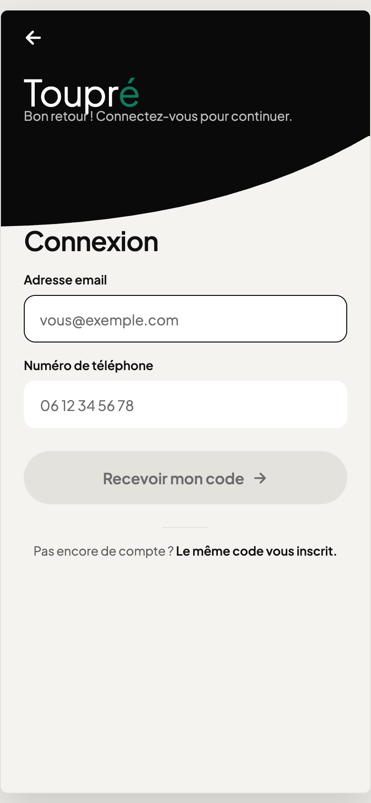
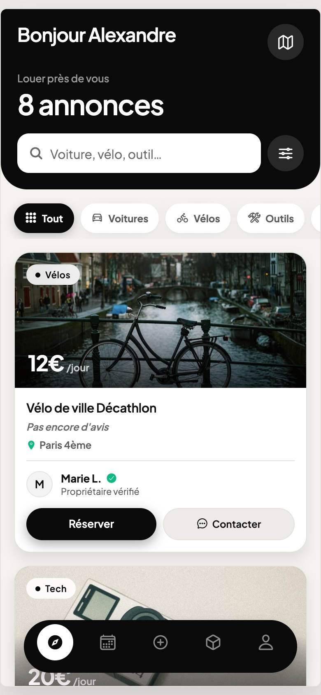
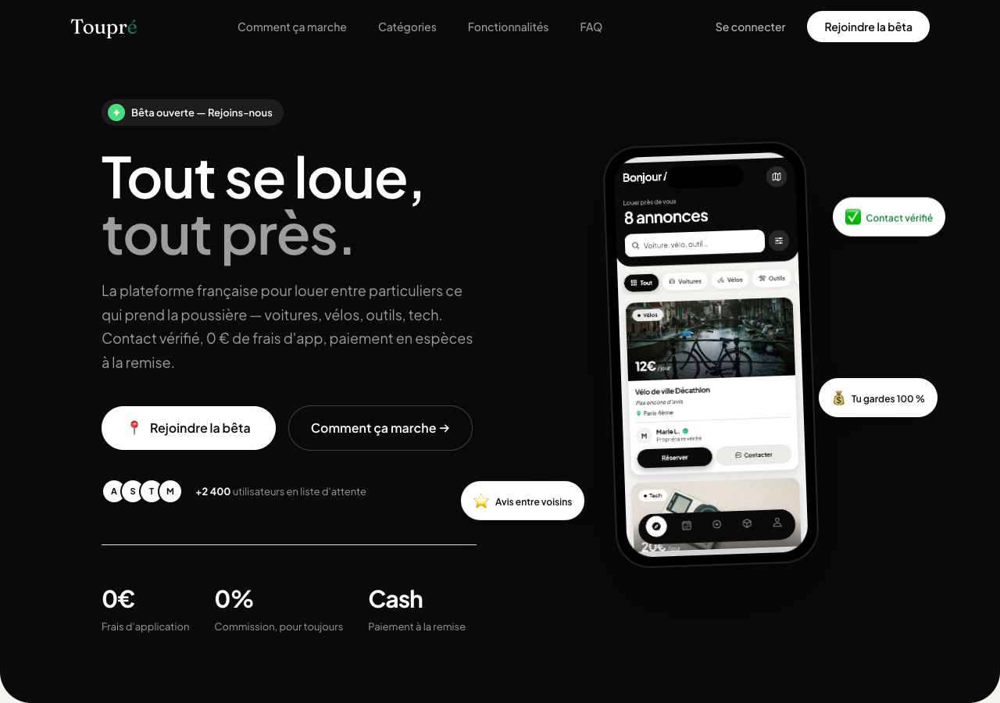
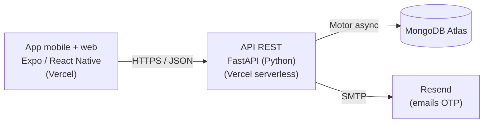

<div align="center">

# Toupré

### Tout se loue, tout près.

**Application de location d'objets entre voisins** — voitures, vélos, outils, matériel photo, camping.
Zéro commission, paiement en espèces à la remise, contact vérifié.

[](https://expo.dev)
[](https://www.typescriptlang.org)
[](https://fastapi.tiangolo.com)
[](https://www.mongodb.com/atlas)
[](https://vercel.com)
[](https://playwright.dev)

**[→ Essayer l'app](https://toupre-app.vercel.app)** · **[→ Site vitrine](https://toupre-tau.vercel.app)**

</div>

---

## À propos

Toupré est une marketplace mobile de location entre particuliers, pensée à l'échelle du quartier.
L'idée : ce qui dort dans un placard (une perceuse, un vélo, un appareil photo) peut dépanner le voisin
d'à côté — sans frais pour l'app, sans commission, avec un paiement en espèces de la main à la main.

Projet **fullstack complet** mené de bout en bout : conception produit, application mobile + web,
API et base de données, authentification, tests end-to-end, et **déploiement cloud**.

> **Statut :** bêta fonctionnelle, déployée. Les comptes de démonstration permettent d'essayer tout le parcours.

## Aperçu

| Connexion (mobile) | Explorer (mobile) |
|:---:|:---:|
|  |  |



## Fonctionnalités

- 🔐 **Connexion sans mot de passe** — code à usage unique (OTP) envoyé par email ; le code vérifie le contact et valide le compte.
- 🧭 **Explorer** — recherche plein-texte (insensible aux accents), filtres par catégorie et prix, carte interactive.
- 📸 **Publier une annonce** — photos compressées à la volée, catégories, prix, localisation.
- 📅 **Réservation** — calendrier maison, dates déjà réservées non sélectionnables, récapitulatif du montant.
- 💬 **Messagerie** — échange locataire ↔ propriétaire, avec filtrage de contenu.
- 🧾 **État des lieux photo** — constat avant/après remise, horodaté, consultable par les deux parties (preuve en cas de litige).
- ⭐ **Avis mutuels** — notation après chaque location, réputation visible.
- 💶 **0 commission, paiement cash** — Toupré ne touche jamais à l'argent et ne stocke aucune coordonnée bancaire.
- ♿ **Accessibilité** — conforme WCAG 2.2 AA (rôles, focus clavier, contrastes vérifiés).

## Architecture



Trois briques découplées : un **front** statique (export web d'Expo Router), une **API** FastAPI
exécutée en serverless, et une base **MongoDB Atlas**. Les emails de connexion partent via Resend.

## Stack technique

| Couche | Technologies |
|---|---|
| **Frontend** | Expo Router (SDK 54), React Native (+ web), TypeScript, react-native-maps, react-native-svg |
| **Backend** | FastAPI, Motor (MongoDB async), Pydantic, PyJWT, bcrypt |
| **Base de données** | MongoDB Atlas |
| **Auth** | OTP email (Resend), JWT + sessions révocables |
| **Tests** | Playwright (19 tests E2E, navigateur réel) |
| **Déploiement** | Vercel (front statique + API Python serverless), MongoDB Atlas |
| **Méthodologie** | Spec-Driven Development (GitHub Spec Kit) + constitution de projet |

## Structure du projet

```
.
├── frontend/          App Expo / React Native (+ export web)
│   ├── app/           Écrans (Expo Router) — explore, booking, listing, messages, profil…
│   ├── src/           Thème, composants, logique d'auth, utilitaires
│   └── e2e/           Tests Playwright
├── backend/           API FastAPI (server.py) + déploiement Vercel (api/, vercel.json)
├── site/              Site vitrine statique (landing, CGU, confidentialité, formulaire de retours)
├── specs/             Spécifications (Spec Kit) : état des lieux, accessibilité, recherche…
└── scripts/           Scripts de build & déploiement
```

## Démarrage local

**Prérequis :** Node 18+, Python 3.11+, MongoDB (ou MongoDB Atlas).

```bash
# 1. Backend (FastAPI + MongoDB)
cd backend
python -m venv .venv && source .venv/bin/activate
pip install -r requirements.txt
cp .env.example .env          # renseigner MONGO_URL, JWT_SECRET, SMTP_*
uvicorn server:app --reload   # http://localhost:8000

# 2. Frontend (Expo web)
cd frontend
npm install
cp .env.example .env          # EXPO_PUBLIC_BACKEND_URL=http://localhost:8000
npx expo start --web
```

## Tests

```bash
./run-e2e.sh          # re-seed Mongo → relance l'API → Playwright (19 tests)
```

Les tests couvrent le parcours complet : connexion OTP, réservation (dates locales),
acceptation propriétaire, état des lieux photo, avis, recherche, calendrier, modération,
accessibilité (rôles + focus clavier), rendu sur petit écran.

## Déploiement

```bash
./scripts/deploy-app.sh       # build + déploie le front web sur Vercel
cd backend && vercel --prod   # déploie l'API
```

---

<div align="center">

Conçu et développé par **Aïmane Ramzi**
© 2026 — Tous droits réservés

</div>
