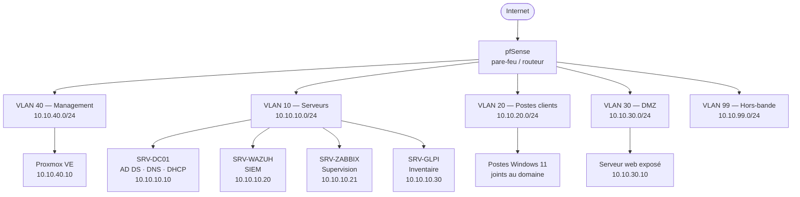

# Homelab — Infrastructure segmentée, supervisée et durcie

Laboratoire d'administration systèmes et réseaux que j'exploite en continu chez moi.
Objectif : pratiquer sur une infrastructure réelle — qui tombe, qu'il faut diagnostiquer et
remettre en service — plutôt que sur des maquettes jetables.

**Aïmane RAMZI** — BTS SIO option SISR · Bachelor 3 Sécurité Informatique (ESGI Paris)
Recherche une alternance d'administrateur systèmes et réseaux en Île-de-France.

---

## En bref

| | |
|---|---|
| **Hyperviseur** | Proxmox VE |
| **Pare-feu / routeur** | pfSense — inter-VLAN, NAT, règles de filtrage |
| **Annuaire** | Windows Server 2022 — AD DS, DNS, DHCP, GPO |
| **Services Linux** | Debian 12 — web interne, dépôt, scripts d'exploitation |
| **Supervision** | Zabbix — hôtes, services, alertes |
| **SIEM** | Wazuh — collecte de journaux, règles de détection |
| **Inventaire / tickets** | GLPI |
| **Sauvegarde** | Proxmox Backup Server + vérification de restauration mensuelle |

Segmentation en 5 VLAN, plan d'adressage documenté, règles inter-VLAN en refus par défaut.

---

## Architecture

Détail du plan d'adressage, des règles de filtrage et des choix de conception :
**[docs/architecture.md](docs/architecture.md)**

---

## Ce que ce lab m'a appris

Le lab n'a d'intérêt que par ce qui casse. Chaque panne est consignée dans le
**[journal d'incidents](docs/journal-incidents.md)** : symptôme, diagnostic, cause racine,
correction, et mesure prise pour éviter la récidive.

Quelques exemples traités :

- Résolution DNS interne cassée après bascule du rôle DHCP — mauvaise option 006 distribuée.
- Postes clients incapables de rejoindre le domaine — dérive d'horloge supérieure à 5 minutes
  (tolérance Kerberos).
- Saturation du stockage Proxmox par les instantanés de sauvegarde — mise en place d'une
  rétention et d'une alerte Zabbix à 80 %.
- Règle inter-VLAN trop permissive détectée lors d'une revue — DMZ qui pouvait joindre le VLAN
  serveurs.

---

## Automatisation

Je scripte les tâches d'exploitation répétitives plutôt que de les refaire à la main.

### PowerShell

| Script | Rôle |
|---|---|
| [`Invoke-ADHealthAudit.ps1`](scripts/powershell/Invoke-ADHealthAudit.ps1) | Audit d'annuaire : comptes inactifs, mots de passe qui n'expirent jamais, appartenance aux groupes privilégiés, postes obsolètes. Export CSV + rapport HTML. |
| [`New-ADUsersFromCsv.ps1`](scripts/powershell/New-ADUsersFromCsv.ps1) | Création en masse de comptes AD depuis un CSV, avec `-WhatIf`, journalisation et contrôle d'unicité. |

### Bash

| Script | Rôle |
|---|---|
| [`audit-durcissement-anssi.sh`](scripts/bash/audit-durcissement-anssi.sh) | Contrôle de configuration d'un hôte Linux au regard des recommandations ANSSI (guide BP-028) : SSH, paramètres noyau, permissions sensibles, politique de mot de passe. Rendu avec score et code de sortie exploitable en CI. |
| [`backup-vers-nas.sh`](scripts/bash/backup-vers-nas.sh) | Sauvegarde incrémentale avec rotation, vérification d'intégrité et compte rendu. |

---

## Procédures d'exploitation

Documenter pour qu'un tiers puisse reprendre la main sans moi — c'est ce que j'ai appris en
milieu hospitalier, où l'astreinte ne peut pas dépendre d'une seule personne.

- [PROC-001 — Création d'un utilisateur Active Directory](docs/procedures/proc-001-creation-utilisateur-ad.md)

---

## Compétences mises en œuvre

**Systèmes** — Windows Server 2022, Active Directory (AD DS, GPO, unités d'organisation),
Debian 12, durcissement selon les recommandations ANSSI.

**Réseaux** — segmentation VLAN, routage inter-VLAN, filtrage en refus par défaut sous pfSense,
DHCP, DNS, NAT, analyse de trafic (Wireshark).

**Sécurité** — SIEM Wazuh (collecte, règles de détection), revue de règles de pare-feu,
gestion des comptes à privilèges, sauvegarde et test de restauration.

**Automatisation** — PowerShell, Bash, Ansible.

---

## Contact

**Aïmane RAMZI** — Bobigny (93)
ramzi.aimane@gmail.com · +33 7 66 51 98 93
[linkedin.com/in/aïmane-ramzi](https://www.linkedin.com/in/a%C3%AFmane-ramzi)
